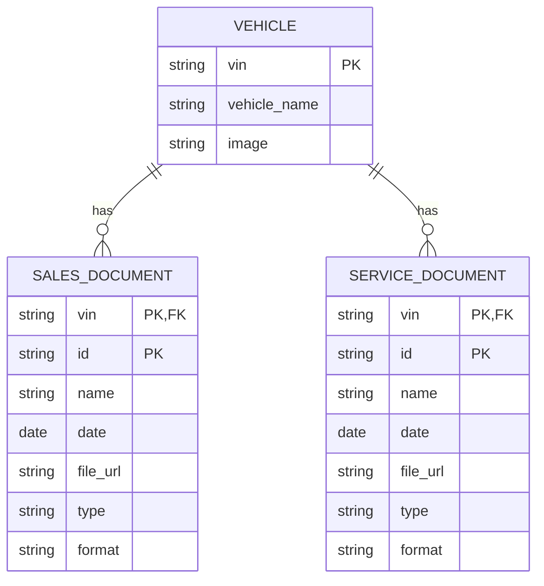

# Keyloop Unified Document Viewer

Technical assessment project for **Scenario D: The Unified Document Viewer**.


## Overview

The application gives users one consolidated view of vehicle-related documents. A user searches by Vehicle Identification Number (VIN), and the Home page combines records from separate Sales System and Service System mock data sources.

## Key Features

### Current behavior

- **Single VIN search:** Validate a VIN and use it as the lookup key for vehicle documents.
- **Parallel aggregation:** Request Sales System and Service System data concurrently to reduce total wait time.
- **Partial failure handling:** Keep successful results if one adapter rejects, and identify the failed source. The current mock adapters do not intentionally inject failures.
- **Unified document list:** Present normalized sales and service records in one chronological view, with a clear source badge on each document.
- **Responsive interaction states:** Provide loading skeletons, useful empty states, inline errors, and retry actions across screen sizes.

## Architecture and System Design

### Document data structure

Mock records are split into three JSON files. Vehicle details live once in `vehicles.json`; each document source has its own file, and each document record refers to a vehicle through `vin`.

`app/mock/vehicles.json`:

```json
{
  "vehicles": [
    {
      "vin": "1HGCM82633A004352",
      "vehicle_name": "Honda Accord",
      "image": "/images/cars/car-5.png"
    }
  ]
}
```

`app/mock/sales-documents.json`:

```json
{
  "documents": [
    {
      "vin": "1HGCM82633A004352",
      "id": "s1",
      "type": "Contract",
      "date": "2025-03-12T10:30:00Z",
      "format": "PDF",
      "name": "Purchase Agreement",
      "file_url": "/files/purchase-pdf.pdf"
    }
  ]
}
```

`app/mock/service-documents.json` has the same record shape, but contains service records. For example:

```json
{
  "documents": [
    {
      "vin": "1HGCM82633A004352",
      "id": "v1",
      "type": "Inspection",
      "date": "2025-03-13T11:00:00Z",
      "format": "PDF",
      "name": "Pre-Delivery Inspection",
      "file_url": "/files/purchase-pdf.pdf"
    }
  ]
}
```

The source is implicit in the file, so raw JSON documents do not include a `source` field. The mock service adds `source: "Sales"` or `source: "Service"` when it maps a record into the shared `VehicleDocument` model. The lookup `vin` is removed from the mapped document because the UI already has the selected vehicle VIN.

The normalized model passed to the document cards and preview is:

```ts
type VehicleDocument = {
  id: string;
  name: string;
  date: string;
  file_url: string;
  type: string;
  source: 'Sales' | 'Service';
  format: 'PDF' | 'DOCX' | 'XLS';
};
```

Document `id` values can repeat for different VINs. A document is therefore identified within a source by the composite key `(vin, id)`; the source file distinguishes Sales IDs from Service IDs.

### Aggregation flow

1. The Home page filters the vehicle catalog by the VIN text and displays matching vehicles.
2. Submitting a valid 17-character VIN starts aggregation for the exact match. Selecting a vehicle card starts the same flow for that vehicle's VIN.
3. `getSalesDocumentsByVin(vin)` and `getServiceDocumentsByVin(vin)` read their own JSON datasets, simulate independent network delays, and filter records by VIN. They are called concurrently with `Promise.allSettled`.
4. The Home page combines successful responses and sorts documents by `date`, newest first. A rejected source is reported while successful records remain visible; if both requests reject, the page shows an error.

These are client-side mock API functions, not HTTP endpoints. Their delays currently differ (350 ms for Sales and 650 ms for Service); the functions do not deliberately simulate failures yet. The UI's partial-failure path is ready for rejected requests when failure simulation or real API calls are added.

### Vehicle-document ERD

The JSON structure represents one vehicle catalog and two document collections. `vin` acts as the foreign key from each source's document records to the vehicle catalog:



Each source uses `(vin, id)` as its composite key. A vehicle can have zero or more documents in either source, including no records in one source while the other source still returns results.

### Current application architecture

The project uses React Router Framework Mode with server-side rendering. Route modules live in `app/routes`, and shared layout and UI components live under `app/components`. Document mock data is imported by `app/features/vehicles/vehicle-api.ts`; only the authentication and Google OAuth flows use server routes. Zustand persists the client-side demo session, while Google OAuth state and identity are handled by server-side session utilities.

## Project Structure

The tree below lists the current application modules, mock data, public assets, and root configuration files. Generated dependencies and build output are omitted.

```text
.
├── .agents/
│   └── skills/react-router/
│       ├── SKILL.md
│       └── references/
│           ├── data-mode.md
│           ├── declarative-mode.md
│           ├── framework-mode.md
│           └── rsc.md
├── app/
│   ├── components/
│   │   ├── atoms/
│   │   │   ├── animated-list-item.tsx
│   │   │   ├── language-select.tsx
│   │   │   └── vehicle-skeletons.tsx
│   │   ├── layout/
│   │   │   ├── app-header.tsx
│   │   │   └── app-sidebar.tsx
│   │   └── ui/
│   │       ├── avatar.tsx
│   │       ├── breadcrumb.tsx
│   │       ├── button.tsx
│   │       ├── card.tsx
│   │       ├── dropdown-menu.tsx
│   │       ├── input.tsx
│   │       ├── label.tsx
│   │       ├── select.tsx
│   │       ├── separator.tsx
│   │       ├── sheet.tsx
│   │       ├── sidebar.tsx
│   │       ├── skeleton.tsx
│   │       └── tooltip.tsx
│   ├── features/
│   │   ├── auth/
│   │   │   ├── auth-gate.tsx
│   │   │   ├── auth-messages.ts
│   │   │   ├── auth-service.ts
│   │   │   ├── auth-storage.ts
│   │   │   ├── auth-store.ts
│   │   │   ├── auth-types.ts
│   │   │   ├── google-env.server.ts
│   │   │   ├── google-oauth.server.ts
│   │   │   ├── google-session.server.ts
│   │   │   ├── login-form.tsx
│   │   │   ├── login-progress.tsx
│   │   │   ├── login-schema.ts
│   │   │   ├── session-bootstrap.tsx
│   │   │   ├── use-login.ts
│   │   │   └── use-logout.ts
│   │   └── vehicles/
│   │       ├── document-card.tsx
│   │       ├── document-labels.ts
│   │       ├── document-preview-sheet.tsx
│   │       ├── vehicle-api.ts
│   │       ├── vehicle-card.tsx
│   │       └── vehicle-types.ts
│   ├── hooks/
│   │   └── use-mobile.tsx
│   ├── i18n/
│   │   ├── i18n.ts
│   │   └── resources.ts         # Vietnamese and English translations
│   ├── lib/
│   │   └── utils.ts
│   ├── mock/
│   │   ├── sales-documents.json
│   │   ├── service-documents.json
│   │   └── vehicles.json
│   ├── providers/
│   │   └── app-providers.tsx
│   ├── routes/
│   │   ├── auth.google.callback.tsx
│   │   ├── auth.google.tsx
│   │   ├── auth.session.tsx
│   │   ├── home.tsx
│   │   ├── index.tsx
│   │   ├── login.tsx
│   │   └── workspace.tsx
│   ├── app.css
│   ├── root.tsx
│   └── routes.ts
├── public/
│   ├── files/                  # PDF, DOCX, and XLSX preview samples
│   ├── icons/                  # Vietnamese and English flag icons
│   ├── images/
│   │   ├── cars/               # Vehicle card images
│   │   └── document-types/     # PDF, DOCX, and XLS icons
│   ├── keyloop-bg.jpg
│   └── keyloop-logo.svg
├── .dockerignore
├── .env.example
├── .gitignore
├── .prettierrc
├── Dockerfile
├── components.json            # shadcn/ui configuration
├── package.json
├── playwright.config.ts
├── pnpm-lock.yaml
├── react-router.config.ts
├── tsconfig.json
├── vite.config.ts
└── vitest.config.ts
```

The main document-viewer implementation is in `app/routes/home.tsx` and `app/features/vehicles/`. `app/features/vehicles/vehicle-types.ts` imports the vehicle catalog, and `app/features/vehicles/vehicle-api.ts` reads the Sales and Service document files. Document previews use sample files from `public/files/`.

## Getting Started

### Prerequisites

- Node.js **22 or newer** (the project uses Vite 8 and React Router 8).
- pnpm, matching the checked-in `pnpm-lock.yaml`.
- Git.

### Installation

```bash
git clone <repository-url>
cd keyloop-unified-document-viewer
pnpm install
pnpm dev
```

Open [http://localhost:5173](http://localhost:5173) in your browser, sign in, and open **Home** to search the mock vehicle catalog by VIN. Submitting a valid exact VIN aggregates Sales and Service document metadata; partial VIN text displays matching vehicle cards.

### Demo login

| Username | Password         |
| -------- | ---------------- |
| `admin`  | `admin123456Aa@` |

### Optional Google OAuth setup

Google login requires a Google OAuth Web application client. Copy `.env.example` to `.env`, provide the client ID and secret, set `AUTH_SESSION_SECRET`, and register `http://localhost:5173/auth/google/callback` as an authorized redirect URI in Google Cloud Console. Keep `.env` out of source control. Google login is a prototype and is independent of the mocked document data.

## Testing and Quality Checks

Run the configured unit and component test suite with:

```bash
pnpm test
```

Additional project checks:

```bash
pnpm run typecheck
pnpm run build
pnpm run test:e2e
```

Vitest is configured to discover tests under `tests/unit/` and `tests/hooks/`, using the JSDOM environment and `tests/setup.ts`. **There is currently no `tests/` directory in the repository**, so the test command may report that no test files were found until tests are added. The test scripts and configuration are present, but this README does not claim unrun tests pass.

## AI Collaboration Narrative

Generative AI was used as an engineering collaborator to accelerate exploration, documentation, and implementation review while keeping technical decisions and final acceptance with the project author.

### Collaboration strategy

- Break work into bounded tasks with explicit acceptance criteria, repository constraints, and expected behavior.
- Use AI to inspect the existing route structure, identify relevant modules, and propose implementation options before changing code.
- Keep the assessment scenario and the actual repository state distinct; generated descriptions must not imply an unfinished capability is already delivered.

### Verification and refinement

- Review generated changes against the real dependency versions, scripts, route configuration, and component conventions in the repository.
- Inspect diffs and search for stale references after structural changes.
- Run type generation and TypeScript checks for code changes; run focused tests when tests exist and are relevant.
- Treat generated code and documentation as drafts: correct mismatched assumptions, remove unsupported claims, and retain human review of behavior and security-sensitive authentication paths.

### Quality assurance and reliability

- Validate authentication inputs and keep session data allowlisted rather than trusting arbitrary persisted values.
- Preserve the existing Google OAuth flow when changing demo username/password behavior.
- Before replacing the mock document sources with production APIs, add server-side request handling, bounded timeouts, explicit per-source failure simulation/tests, and response validation. The current client-side adapters demonstrate aggregation behavior but are not production API integrations.
- Prefer observable evidence from typechecks, tests, and build output over claims based only on generated suggestions.

AI assistance supports the engineering process; it does not replace code review, security review, or verification against the assessment requirements.
